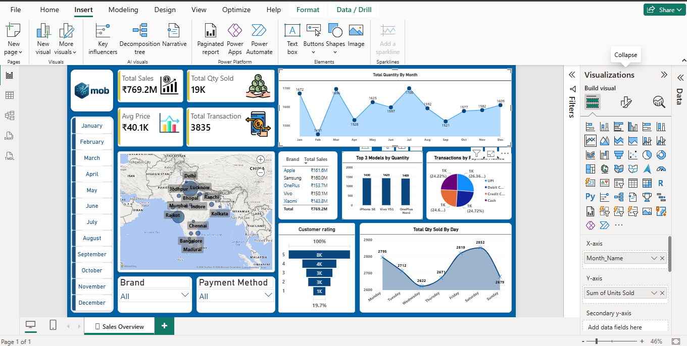

# 📱 Mobile Sales Analysis Dashboard (Power BI)

Interactive Power BI dashboard analyzing mobile sales by brand, city, payment method and customer ratings.

## 📌 Key Metrics
- Total Sales: ₹769.2M
- Quantity Sold: 19K units
- Transactions: 4K
- Average Price: ₹40.1K

## 🔍 Key Insights
- Apple leads in revenue, followed closely by Samsung and OnePlus
- iPhone SE, Vivo Y51 and OnePlus Nord are the top 3 models by quantity
- Payments are almost evenly split across UPI, Debit Card, Credit Card and Cash
- Saturday has the highest quantity sold

## 🛠️ Tools Used
Power BI, DAX, Data Modeling

## 📂 Files
- `Mobile_sales_Project.pbix`: Power BI dashboard file
- `Dashboard.png`: dashboard screenshot

## 📫 Contact
[LinkedIn](https://www.linkedin.com/in/rohitkannaujiya/) | kannaujiyarohit376@gmail.com
